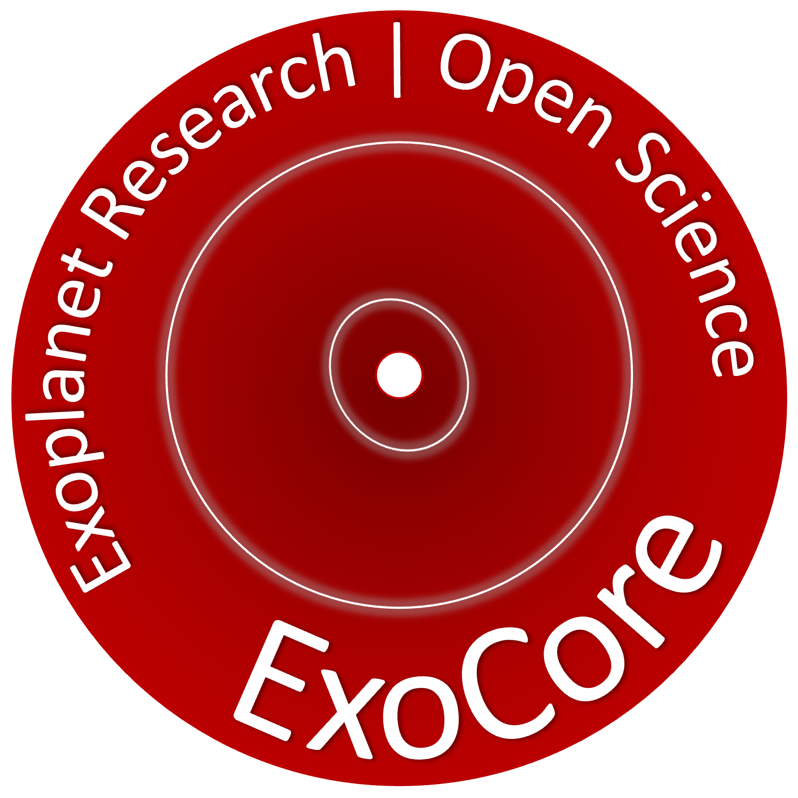
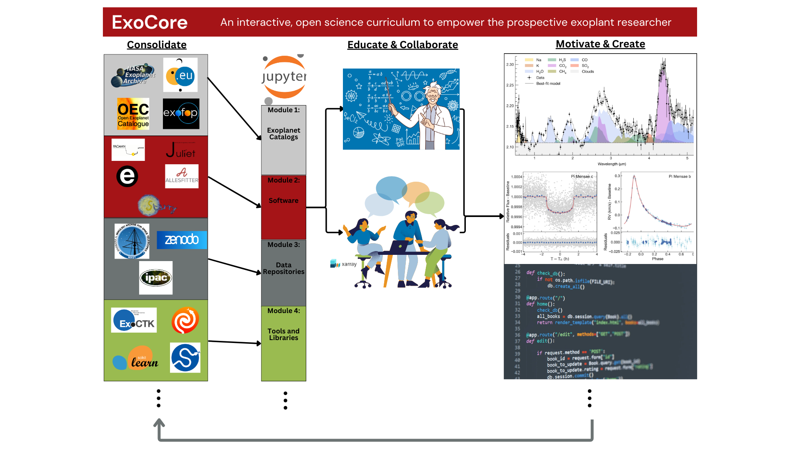

# ExoCore

  

# Introduction
Where do we find the data, what do the columns mean, and how do we turn them into a result someone else can reproduce? We built ExoCore around the practical questions that come up when entering exoplanet research. Developed as part of NASA ScienceCore, it complements Open Science 101 with interactive Jupyter notebooks on catalogs, data archives, scientific Python, analysis software, citizen science, and research communities. Each lesson connects a scientific question to its data, calculation, and assumptions.

# Intended Learning Outcomes

After completing relevant ExoCore modules, learners should be able to
* locate and evaluate exoplanet catalogs, observations, software, and professional resources,
* reproduce a documented workflow while preserving units, metadata, dependencies, and provenance,
* adapt a worked example to a related research question and justify each major analysis choice.

The lessons are aimed at advanced undergraduates, beginning graduate students, and researchers entering exoplanet science.

Please refer to [this presentation](https://astromusers.wustl.edu/AAS245_ExoCore_Workshop_Presentation_20250113.pptx) and [worksheet](https://astromusers.wustl.edu/AAS245_ExoCore_Workshop_Handout_20250113.pdf) of a workshop our team organized during AAS 245 in National Harbor, Maryland, on January 13, 2025, sponsored by an AAS Education & Professional Development (AAS-EPD) grant.

# Modules
ExoCore is divided into **seven** modules that categorize lessons based on a particular aspect of exoplanet research. They include:

* Catalogs
* Data Repositories
* Data Structures
* Data Analysis and Modeling Software
* Utility Software
* Citizen Science
* Exoplanet Resources and Collaborations

Module descriptions, learning outcomes, activities, and lesson links are available in the canonical [ExoCore curriculum](./ExoCore/Curriculum/ExoCore.ipynb) notebook.

# Accessing ExoCore
Launch the ExoCore notebooks in Binder with the button below. Binder builds
their environment from the repository's `environment.yml`.

## Local paths

From the checkout root, source `scripts/set_repository_path.sh` to set `EXOCORE_PATH` in the current shell. The repository-local `data/` and `visuals/` directories are ignored by Git for inputs and generated figures.

# Plot backgrounds

The plotting lessons and their worked solutions include a setup cell with
`typeplotback = 'white'`. Set it to `'dark'` and rerun the setup to use a dark
background with white axes. TDpy supplies the shared styling and is included
in the main environment. The Lightkurve examples also apply the selected theme
when displaying figures created by the library.

# Contributing to ExoCore

If a step confused you when you first entered the field, it is probably worth a lesson. We welcome contributions, especially from early-career researchers who can make those steps easier for the next person. Reach us at `tansu@wustl.edu` to contribute to the curriculum.

# ExoCore Team
ExoCore is developed by members of AstroMusers in the Department of Physics at Washington University in St. Louis. Nathan Whitsett and Bryce Wedig are the leading developers. The other contributors to ExoCore include Ekrem Esmer, Zifan Lin, Jackie Vazquez, Aavik Wadivkar, Gabriella Jager, and Sophia Acker. Tansu Daylan is the principal investigator.

# Citing ExoCore
You can cite ExoCore and its contributors using the "Cite this repository" drop-down in the "About" section of ExoCore's [GitHub page](https://github.com/AstroMusers/ExoCore).

# Funding Acknowledgment
We acknowledge support from NASA through the grant 80NSSC23K0865 and by the McDonnell Center for the Space Sciences (MCSS) at Washington University in St. Louis.
